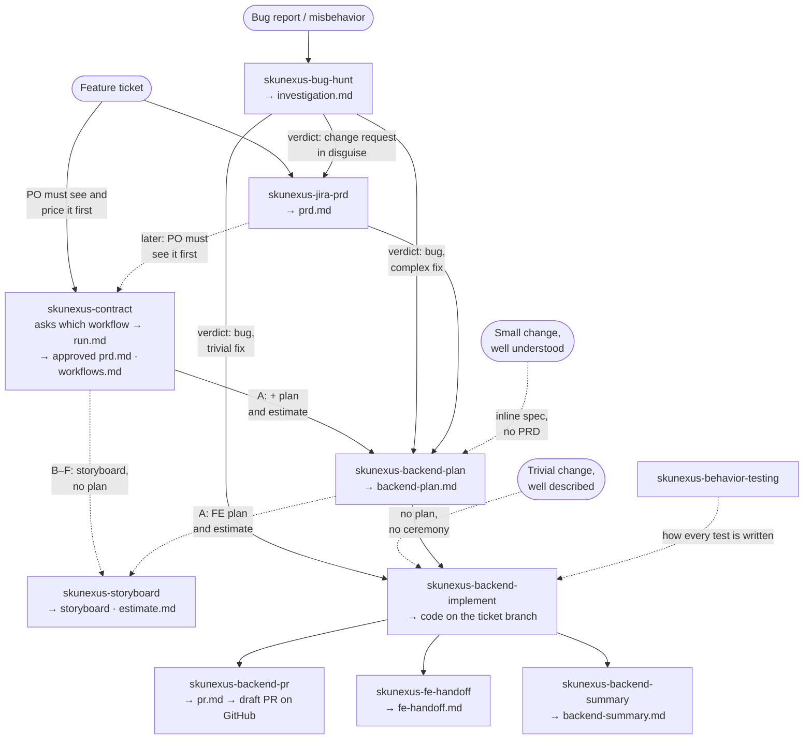

# skunexus-ai

Claude Code skills that implement the **SkuNexus engineering AI workflow**: a pipeline that takes a Jira ticket (or a bug report, or a change described in chat) through requirements, planning, implementation, and the wrap-up documents — with you approving every deliverable before the next step builds on it.

A *skill* is a markdown instruction set (`SKILL.md`) that Claude Code loads automatically when your request matches it. You don't have to invoke skills by name — saying *"let's start PHG-418"* or *"investigate this bug"* triggers the right one. Each section below lists example phrases.

---

## Setup

1. **Install the skills** — symlink (recommended: `git pull` updates propagate) or copy each skill directory into `~/.claude/skills/`:

   ```bash
   git clone <this-repo> && cd skunexus-ai
   ln -s "$PWD"/skills/skunexus-* ~/.claude/skills/
   ```

   Install the skills together, in one skills folder: they read each other by sibling path. `skunexus-storyboard` and `skunexus-backend-plan`'s subagent drafting read `skunexus-contract` (its model and check script), and `skunexus-contract` reads `skunexus-jira-prd`'s PRD template.

   `skunexus-contract`, `skunexus-storyboard` and `skunexus-backend-plan`'s subagent drafting also spawn four subagent types (`agents/sn-*.md`: model, effort and a lean tool list per role). Install them the same way:

   ```bash
   mkdir -p ~/.claude/agents && ln -s "$PWD"/agents/sn-*.md ~/.claude/agents/
   ```

   Optional: the rule that keeps the teammate profiles its simulated reviewers read (`rules/team-personas.md`; it applies in every project, so Claude logs review observations while you work):

   ```bash
   mkdir -p ~/.claude/rules && ln -s "$PWD"/rules/team-personas.md ~/.claude/rules/
   ```

   **Upgrading:** re-run the `ln -s` lines (the "File exists" errors are harmless: existing links already follow `git pull`), replace any copied `sn-*.md` agent or rule with a link, and remove `~/.claude/skills/skunexus-prd-prototype` if you copied it in: `skunexus-contract` and `skunexus-storyboard` replace it.

2. **Prerequisites** the skills rely on:

   | Dependency | Needed by | For |
   |---|---|---|
   | **[Atlassian Rovo MCP Server](https://github.com/atlassian/atlassian-mcp-server)** (Jira): `claude mcp add --transport http --scope user atlassian https://mcp.atlassian.com/v2/mcp`, then `/mcp` to sign in. Keep the server name `atlassian`, or use the claude.ai Atlassian connector: the `sn-*` agents' tool lists name these two | `skunexus-jira-prd`, `skunexus-bug-hunt`, `skunexus-contract` | Fetching and distilling tickets. `skunexus-contract` takes the cloudId from the repo `CLAUDE.md` Atlassian rules, or asks you once for the Jira site URL |
   | **Context7 MCP** + the `skunexus-docs-c7` skill | nearly every skill | Building the platform mental model (command bus, plugins, state machines) before touching code. ⚠️ `skunexus-docs-c7` is **not in this repo yet** — get it from a teammate until it's added. |
   | **Python 3.8+** as `python3` (standard library only). Optional: `tesseract` (OCR of Jira image attachments; without it the images are listed for you to review) and Node (also syntax-checks the storyboard's script with `node --check`). Run Claude Code on Linux, macOS or WSL | `skunexus-contract`, `skunexus-storyboard`, `skunexus-backend-plan` (subagent drafting) | The check scripts (`check-contract.py`, `check-storyboard.py`, `check-plan.py`) |
   | **`gh` CLI**, authenticated | `skunexus-backend-pr` | Pushing the branch and opening the draft PR |
   | **Pest** (client repos) | `skunexus-behavior-testing` | Decides the authoring syntax: Pest where installed, PHPUnit otherwise (core). One-time install: `references/pest-style-guide.md` §0.1 |
   | **A PHP runner** — host PHP or Docker (`docker compose exec <app>`, `sail`) | `skunexus-backend-implement`, `skunexus-behavior-testing` | Running the tests Claude writes. Detected per repo — name it in the repo's `CLAUDE.md` and every test command gets the right prefix |
   | **SN docs checkout** in the client repo's `.ai/skunexus-docs/`: from the client repo, `git clone git@github.com:SkuNexus-Devs/skunexus-docs-tryout.git .ai/skunexus-docs` | the `sn-*` agents | The platform model the researchers, code mappers and plan drafters read |
   | **[Chrome DevTools MCP](https://github.com/ChromeDevTools/chrome-devtools-mcp)**: `claude mcp add chrome-devtools --scope user npx chrome-devtools-mcp@latest` (Node 20.19+, current Chrome; use this command, not the vendor's plugin install, which prefixes the tool names the agents call) + your **local SN app** running, logged in once in the browser it opens | `skunexus-storyboard` | Capturing the stock pages the storyboard redraws, and clicking through the storyboard. With no browser it ships marked "unclicked" |
   | **[Claude Code artifacts](https://code.claude.com/docs/en/artifacts)**: a Pro, Max, Team or Enterprise plan, Claude Code signed in with `/login` (a claude.ai account, not an API key), v2.1.281+ | `skunexus-storyboard` | Publishing the storyboard as a private artifact |
   | **`~/.claude/CLAUDE.md` Projects/People tables, `~/.claude/people/` profiles** (optional), kept by Anthropic's [productivity plugin](https://github.com/anthropics/knowledge-work-plugins/tree/main/productivity): `claude plugin marketplace add anthropics/knowledge-work-plugins`, `claude plugin install productivity@knowledge-work-plugins`, then `/productivity:start` from `~/.claude` and `ln -s ~/.claude/memory/people ~/.claude/people`; the profiles' persona sections come from the `rules/team-personas.md` rule (step 1) | `skunexus-contract`, `skunexus-storyboard` | Who the PO, tech lead and FE developer are, and the grounding for the panel's simulated reviews. Without them the skill asks for the names and runs each persona from its documented role |

3. **Run Claude Code in the repo you're working on** (e.g. `skunexus-client-*`), not in this one. All workflow artifacts land in `.ai/<TICKET>/` inside that working repo.

---

## The workflow at a glance

**Two front doors for tickets, chosen by one question: must the PO see and price it before it is built?** Yes: `/skunexus-contract <TICKET>`. It owns `run.md`, asks which workflow you want (A–F below), and drives the chain: it calls `skunexus-jira-prd` for the interview, `skunexus-backend-plan` for the plan and `skunexus-storyboard` for the drawing, each at its turn. No: `/skunexus-jira-prd <TICKET>` (*"let's start PHG-418"*), the regular route, unchanged.



Two front doors for tickets, chosen by whether the PO must see and price it first, one for bugs, one build spine, three wrap-up documents. You don't always start at the top — the pipeline **right-sizes its ceremony**: a trivial change can go straight to implementation with no artifacts at all, and downstream skills fall back gracefully (`prd.md` → `investigation.md` → the plan's inline Goal & Acceptance → the real diff).

### Which skill do I start with?

| Situation | Start with |
|---|---|
| Any ticket, not sure which route | Ask: must the PO see and price it before it is built? Yes: `skunexus-contract` — *"/skunexus-contract FFD-17"* asks one question (the workflow menu below). No: `skunexus-jira-prd` — *"let's start PHG-418"* |
| Feature ticket, requirements not nailed down | `skunexus-jira-prd` — *"let's start PHG-418"* |
| Client ticket the PO must see and price first: a clickable mock-up plus an hours estimate | `skunexus-contract`, workflow `prd-storyboard-estimate`: then `skunexus-backend-plan` and `skunexus-storyboard`, chained — *"PRD, storyboard and estimate for FFD-40"* |
| The same, while you're away (a small or medium UI ticket with a clear ask) | `skunexus-contract`, workflow `unattended`: it stops at a Draft, an internal storyboard and a ranked decision list, with no plan and no hours — *"I'm away: run FFD-17 without stopping"* |
| An unattended run has stopped; you want a draft to discuss with the PO and the FE developer | `skunexus-contract`, workflow `triage`, then `skunexus-storyboard`: you rule the guesses that move scope or price, and the storyboard is rebuilt as "Draft for discussion" — *"triage FFD-17"* |
| A BE-only, integration or data-contract ticket | `skunexus-jira-prd`, the regular route (then `skunexus-backend-plan`), no storyboard — *"let's start RL-47"* |
| The ticket changed under a contract | `skunexus-contract`, workflow `re-pull` — *"re-pull FFD-14 and diff it"* |
| A mock-up fast, no full PRD | `skunexus-contract`, workflow `lite-storyboard` (a lite contract), then `skunexus-storyboard` — *"a quick storyboard, no PRD"* |
| PRD and plan exist; the PO needs the storyboard, FE plan or estimate | `skunexus-storyboard`, workflow `storyboard-only` — *"PRD and plan are done, just build the storyboard"* |
| A client ticket half done | the workflow recorded in `run.md`, at the skill that owns the first missing artifact — *"continue FFD-40"* |
| Something is broken, wrong, or regressed (ticket or not) | `skunexus-bug-hunt` — *"investigate PHG-456"*, *"orders are stuck in status X"* |
| Requirements are agreed, work needs a task breakdown | `skunexus-backend-plan` — *"plan the backend for PHG-418"*, *"skip the PRD, just plan this"* |
| A big plan, drafted in parallel | `skunexus-backend-plan`, `plan-fan-out` on (any workflow) — *"plan it, fan out to subagents"* |
| An approved plan exists | `skunexus-backend-implement` — *"implement the plan"*, *"let's do T3"* |
| Trivial, well-described change | `skunexus-backend-implement` — *"just add X to endpoint Y, skip the ceremony"* |
| QA findings / review comments on implemented work | `skunexus-backend-implement` — *"we need to change how X works"* |
| Code is approved, needs a PR | `skunexus-backend-pr` — *"draft the PR"* |
| Frontend team needs the API contract | `skunexus-fe-handoff` — *"prepare the FE handoff"* |
| Ticket's work should be documented for the team | `skunexus-backend-summary` — *"write the backend summary"* |
| Writing, converting, naming or placing a test | `skunexus-behavior-testing` — *"write a test for this command"*, *"where does this test go"* |

Full attended (workflow `prd-storyboard-estimate`, *"PRD, storyboard and estimate for X"*) is still the route when the first share must carry an estimate, when more than about 7 questions for the PO remain after a triage, or when the ticket is large.

### Workflows

`skunexus-contract` and `skunexus-storyboard` run a named **workflow**: a route through the steps, a stop point, and the settings it fixes. A plain `/skunexus-contract FFD-17` asks you one question, the menu below; one letter is enough. A shortcut phrase or an argument (`/skunexus-contract FFD-17 workflow=unattended`) picks the workflow and skips the question. Either way the skill first echoes one line, e.g. *Working with workflow `prd-storyboard` (PRD + storyboard): evidence → interview → contract → storyboard v2. Attended; stops at each gate. Say "workflow <name>" to switch.*, then records the workflow in `.ai/<TICKET>/run.md`, so a resume never changes behaviour because of how an ask was phrased.

| Letter | Workflow | Label | Stops at |
|---|---|---|---|
| A | `prd-storyboard-estimate` | PRD + storyboard + estimate | the estimate posted; scope and price go to the PO together |
| B | `prd-storyboard` | PRD + storyboard | storyboard v2 shared for scope (no BE plan, no hours) |
| C | `lite-storyboard` | lite + storyboard | storyboard v1, internal only |
| D | `lite` | lite only | the lite contract |
| E | `unattended` | unattended draft, then triage | a ranked decision list; nothing shared until you triage |
| F | `storyboard-only` | just the storyboard (PRD exists; offered only then) | storyboard v2 |

Follow-ups, offered only when they apply: `triage` (after an unattended run has stopped: you rule the guesses that move scope or price, and the storyboard is rebuilt as "Draft for discussion") and `re-pull` (re-pull the ticket, diff it, rule on the changes).

| Shortcut phrase | Workflow |
|---|---|
| *"PRD, storyboard and estimate for FFD-40"* | `prd-storyboard-estimate` |
| *"I'm away: run FFD-17 without stopping"* | `unattended` |
| *"a quick storyboard, no PRD"* | `lite-storyboard` |
| *"PRD and plan are done, just build the storyboard"* | `storyboard-only` |
| *"re-pull FFD-14 and diff it"* | `re-pull` |
| *"triage FFD-17"* | `triage` |
| *"plan it, fan out to subagents"* | unchanged; switches `plan-fan-out` on (`skunexus-backend-plan` drafts in parallel) |
| *"continue FFD-40"* | the one recorded in `run.md` |

Only your explicit words switch the workflow; each switch is logged in `run.md`. The routes, the question, the settings each workflow fixes (`mode`, `chain`) and the routing by ticket kind are in `skills/skunexus-contract/references/model.md` §8.

## What to expect from every skill

These conventions hold across the whole pipeline — internalizing them once is most of the onboarding.

- **You will be interviewed.** The skills never guess: any ambiguous value, boundary, or intent becomes a question to you — usually one focused question at a time, with concrete options to pick from. This is by design; a confident wrong assumption is the most expensive failure mode. Answering "just decide" defeats the point. (`skunexus-contract` turns what is left after its review panel into marked, visible assumptions instead of more questions; you can overturn any of them.)
- **Every deliverable is a gate.** Documents start as `Status: Draft` and flip to `Approved` **only when you explicitly say so**. Silence is not approval; approving the code is not approving the PR text. Nothing proceeds downstream, and nothing reaches GitHub, without your explicit go-ahead.
- **You review documents in your editor, not in chat.** When a draft is ready, the skill points you at the file (e.g. `.ai/PHG-418/backend-plan.md`) and waits. Read it there, come back with issues or approval — chat walkthroughs of a document you can open are deliberately avoided.
- **Everything resumes from disk.** The `.ai/<TICKET>/` files are the complete state. You can close your laptop, clear context, or open a fresh conversation days later and say *"continue the plan for PHG-418"* — the skill re-reads the folder, recaps where things stand in one line, and picks up.
- **Claude never verifies against your environment.** No migrations, no tinker, no hitting endpoints, no DB queries. Instead it hands you the exact checks to run (*"run `SELECT … WHERE order_id = 4711`"*, the task's *Sanity-check now* list) and treats your results as evidence. The honest handoff is "here's what I built and how you can confirm it". **The one exception is the test suite** — behavior tests run on in-memory SQLite, which isn't your environment, so Claude writes them, runs them — through your repo's PHP runner, host or Docker — and shows you the real output, against a baseline of what was already red before the run and with one full-suite run before hand-off. That exception is the point: it closes the verify loop. A test Claude can run is the one check it can perform on itself, so a regression gets caught and fixed inside the run instead of parked at your review — which is what makes an orchestrated wave of tasks worth trusting. Everything else on that list is still yours. `skunexus-contract` and `skunexus-storyboard` are the other exception: to redraw stock pages faithfully the storyboard browses your **local** app (writes only on your explicit grant, logged for undo, never queue workers), and both run **read-only** probes against client sandboxes. Neither writes to Jira, Confluence or a client system.
- **Ceremony is proportional.** A one-line change gets no PRD, no plan file, no decisions log. Skills escalate visibly when a "trivial" change turns out not to be — and *you* decide whether to escalate or continue.
- **Each skill stops at its boundary.** The PRD skill won't start designing; the plan skill won't start coding; the PR skill won't write testing steps. When a skill finishes, it names the next step and stops — you invoke it when ready. The exception: ask `skunexus-contract` for the whole chain, and the contract and storyboard skills load the next skill instead of stopping. They still stop at every gate, and after each approval (G2, G3, G5) you start a fresh session with *"continue <TICKET>"*.

### The artifact folder: `.ai/<TICKET>/`

Every ticket (or ad-hoc slug for ticketless work) gets one folder in the working repo:

| File | Written by | What it is |
|---|---|---|
| `jira-summary.md` | jira-prd / bug-hunt / contract | Distilled ticket (a subagent reads the noisy Jira payload so your context doesn't) |
| `prd.md` | jira-prd or contract (or a lite version by backend-plan) | The **contract**: requirements `R1…Rn`, scope, acceptance criteria |
| `investigation.md` | bug-hunt | Evidence-backed verdict, root cause, proposed fix, acceptance `A1…An` |
| `backend-plan.md` | backend-plan | The task DAG; live tracker — checkboxes and statuses updated as code lands |
| `decisions.md` | backend-plan / backend-implement | ADR-style log of real technical forks — **created only when earned; absent is the normal case** |
| `pr.md`, `pr2.md`… | backend-pr | The PR title + body, exactly as posted (one file per PR round) |
| `fe-handoff.md` | fe-handoff | Self-contained API contract for the FE team |
| `backend-summary.md` | backend-summary | Current-state feature doc of what the ticket implemented |
| `workflows.md` | contract | The use cases (steps `s1.3`: actor, trigger, before → after, cited ids) and the PO's priced parts; the second half of the contract |
| `run.md` | contract / storyboard | The workflow, the settings it fixes (`mode`, `chain`), `plan-fan-out`, and their dated History, including triages |
| `feedback.md` | storyboard, backend-plan, contract's panel and re-pulls, you | Every question or change against the contract (`WRONG` / `CHOICE` / `SILENCE` / `CHANGE`); only contract's rulings change the contract |
| `jira/`, `jira-<DATE>/`, `jira-diff-<DATE>.md` | contract | The whole ticket pulled as files (description, comments, changelog, attachments); later re-pulls and their diff. The first pull is never overwritten |
| `input/` | you | Call transcripts, Basecamp posts and attachments the skill asked you for |
| `research/` | contract | One file per researcher: evidence and a proposed default for each open question |
| `review/` | contract | Frozen contract snapshots (`prd-v<N>-<DATE>.md`, `workflows-v<N>-<DATE>.md`), the PO baseline, the panel's reviewer files (`review/panel/`, git-ignored) and `panel-synthesis.md`, re-pull re-evaluations (`reeval-<DATE>/`), decision lists, and the `*-BRIEF.md` files its agents work from |
| `prototype/` | storyboard | `sn-baseline.md` (text capture of the stock pages), `<slug>-storyboard.html` (+ `-v<N>` backups), `artifact.md` (URL and version table); raw captures in `screens/` are never published |
| `plan-parts/` | backend-plan (subagent drafting) | The map and plan briefs, code maps and per-drafter parts that `check-plan.py` assembles into `backend-plan.md` |
| `frontend-plan.md` | storyboard | Each storyboard page → components, the plan's API calls, validation, FE hours; the FE developer confirms or replaces it |
| `estimate.md` | storyboard | Part · Hours · Scope (BE hours from the plan, FE hours from `frontend-plan.md`): a draft for the Jira estimate you post yourself |

---

## The skills

### 1. `skunexus-jira-prd` — Jira ticket → PRD

**When:** starting a feature ticket, before any planning or code. *"Let's start PHG-418"*, *"write a PRD for this ticket"*, *"scope this out"*.

**What happens:** a subagent fetches and distills the Jira ticket in the background (including the *Implementation Plan* and *Testing Steps* custom fields) while you're asked for any context that never made it into Jira. Then the interview: the skill works through every ambiguity **and every silence** — the things a change of this shape must handle that the ticket never mentions (error paths, edge inputs, affected surfaces). Answers are promoted into the PRD live.

**You get:** `prd.md` — Summary, Problem, Goals & Non-Goals, testable requirements `R1…Rn`, Scope, Acceptance Criteria, Open Questions. Product-level: *what* and *why*, never *how*. Your "how" ideas get parked in a *Notes for Design* footer for the planning skill.

**It will not** design the solution, estimate, or start coding — it stops at the approved PRD.

### 2. `skunexus-bug-hunt` — bug report → investigated verdict

**When:** something is broken, wrong, or regressed — a bug-flavored ticket **or** an issue described in chat with no ticket. Runs *instead of* the PRD skill. *"Investigate PHG-456"*, *"X throws an error"*, *"QA found this"*, *"the bug is probably in `<file>`, we just need to…"*.

**What happens:** an interview pins down expected vs. actual behavior and a concrete anchor (an order ID, a log line, repro steps) before any code is read. Then a **static** hunt: docs mental model, tracing the causal path, git archaeology to find whether the behavior was introduced deliberately. Anything only knowable at runtime becomes a precise check *you* run (a query, a log to pull) — your answers loop back in as evidence. If you already described the fix, the skill shifts to *verifying* your diagnosis instead of re-deriving it — a much shorter run.

**You get:** `investigation.md` with exactly one of four verdicts, each with evidence-cited analysis:

| Verdict | Then |
|---|---|
| **Confirmed bug** | Proposed fix ("what to change, where") + acceptance `A1…An` + route: trivial → implement directly, complex → plan first |
| **Feature change request in disguise** | Route to `skunexus-jira-prd`; the investigation becomes its upfront context |
| **Works as designed** | Evidence of the design intent; you decide whether to escalate to a change request |
| **Cannot confirm statically** | Competing hypotheses + the discriminating checks for you to run; results reopen the hunt |

**It will not** implement, plan the fix in tasks, or run anything against your environment.

### 3. `skunexus-backend-plan` — requirements → task DAG

**When:** requirements are agreed (or the change is small enough to scope inline) and the work needs a breakdown. *"Plan the backend for PHG-418"*, *"break this into tasks"*, *"skip the PRD, just plan this"*.

**What happens:** the skill first establishes the acceptance to plan against, at the lightest safe weight — an approved PRD, an approved investigation (bug route), a brief scoping pass written as a lite PRD, or just a 2–3-line Goal & Acceptance block inside the plan itself. Then subagents **map the real codebase** (domains, commands/handlers, HTTP edge, GraphQL, persistence, conventions, exact signatures) so every task names real files and patterns to mirror — never imagination. Review is manifest-first: you react to the DAG's *shape* in chat (missing tasks, wrong dependencies, merges/splits), then read the full document in your editor. Edits ripple: changing one task triggers a sweep of its DAG neighbours, and you're told what changed and what was checked-but-fine.

**You get:** `backend-plan.md` — a Task Manifest (IDs, `depends_on`, which requirement each task satisfies), execution waves showing what can run in parallel, and per-task flat checkbox steps with exact files/classes named inline, self-contained enough that an implementation agent never has to ask what was meant. Plus `decisions.md` — but only if planning produced a genuine fork worth recording.

**With subagents (opt-in):** ask for it (*"fan out to subagents to build the plan"*) and drafters write the tasks in parallel from saved code maps and one shared brief; `scripts/check-plan.py` assembles them into the same `backend-plan.md` and checks dependencies, waves and criterion coverage. It buys wall-clock time and is never switched on by plan size alone.

**It will not** write code, and it won't plan against an unapproved (Draft) PRD without your explicit say-so.

### 4. `skunexus-backend-implement` — plan → working code

**When:** executing planned work, making a small direct change, or applying follow-up changes to implemented work. *"Implement the plan"*, *"what should I pick up next"*, *"let's do T3"*, *"orchestrate the rest"*, *"just add X to endpoint Y, skip the ceremony"*, *"QA found these issues"*.

**What happens** — three doors, chosen by what exists:

- **Door A — a plan exists.** You pick the mode: **task-by-task** (implemented in-conversation, you review each task's diff before the next starts — best when you want to steer) or **orchestrate** (subagents implement everything in parallel where the DAG and file-sets allow — in one shared checkout, or each in its own git worktree via Claude Code's `isolation: worktree`, which PhpStorm opens as its own root; you review the whole branch once at the end — best when the plan is settled). Default commit convention: one commit per task, `<TICKET>: <summary>`. Whether a plan gets tests at all is decided at planning time and recorded in its header (`> Tests: behavior` or `> Tests: none — <why>`). With `behavior`, you pick **when tests are written**: *hybrid* (the default — each behavior-bearing task's tests land and run right after its code), *full post-facto* (one test pass at the end, reviewed as its own step) or *no tests* for this run. A `none` plan skips the question entirely.
- **Door B — no plan.** For a trivial, well-described change: implemented directly, no artifacts, the diff is the record. If it stops being trivial mid-way, the skill stops, summarizes what it learned, and recommends escalating to planning — your call.
- **Door C — changes on implemented work.** Your conclusions, QA findings, or relayed PR-review comments get triaged item-by-item to the right altitude: code fix, plan amendment, PRD patch, or a `decisions.md` supersede. Items contradicting a recorded decision are flagged with the original rationale so settled forks don't get re-litigated by accident.

Throughout, the plan's checkboxes and statuses are kept truthful as code lands — the plan file is the single place to see where the ticket stands.

**You get:** working code on the ticket branch, reviewed by you in your editor, with artifacts that still tell the truth — plus the per-task *Sanity-check now* list of environment checks **you** run (migrations, tinker, endpoints are never run by Claude).

**It will not** produce the plan, write the PR description, or claim anything is "verified" that it can only check statically.

### 5. `skunexus-backend-pr` — branch → draft PR

**When:** the code is approved and needs a PR — or an existing PR's description went stale. *"Draft the PR"*, *"open a PR for PHG-418"*, *"update the PR description after the review changes"*.

**What happens:** the skill reads the merge-base diff and the ticket artifacts (PRD/decisions for the *why*, the diff as final authority on the *what*), detects PR history (open PR → propose updating just the stale parts; earlier merged PR on the ticket → propose a delta-only description), and sweeps for the things reviewers must be told: env/config changes existing installs must apply, migrations and their risks, before/after behavior with real examples. Any why-gap it can't recover from artifacts becomes a targeted question to you *before* drafting.

**You get:** `.ai/<TICKET>/pr.md` — title + body in one of the blessed shapes (behavior change / new feature / bug fix), wrapped for comfortable reading in your editor; the body is unwrapped only on its way to GitHub, because GFM turns every newline in a PR description into a `<br>` (see [Skill helpers](#skill-helpers)). Review it in your editor; **only on your explicit "post it"** does the skill push the branch and open a **draft** PR via `gh` (or edit the existing one). The URL is written back into the file.

**It will not** post anything before approval, mark the PR ready-for-review, set reviewers/labels, or include FE handoff notes and testing steps — those are separate skills.

### 6. `skunexus-fe-handoff` — backend work → FE contract

**When:** the feature has a frontend side and the FE team (human or AI) needs the API. *"Prepare the FE handoff"*, *"what does frontend need from this"*. Run it after implementation settles; refresh it after backend changes (*"the endpoint changed, update the handoff"*).

**What happens:** the skill reconstructs the feature as a **user journey** and derives every contract from real code: GraphQL reads (actual fields, filters, a complete example query + response), REST writes (example request, the validation table from the FormRequest, success and every error shape), permissions as *effective behavior*, enum/state lists, config-dependent behavior. Every operation is flagged **NEW** / **CHANGED** / existing.

**You get:** `fe-handoff.md` — fully self-contained for a reader who **cannot open the backend repo**: no class names, no file paths, only HTTP, GraphQL, and feature language, ordered by the flow. Updates never restructure prose that's still accurate — the file may already be in FE hands.

**It will not** prescribe UI/UX, include testing steps, or leak backend internals.

### 7. `skunexus-backend-summary` — ticket → feature doc

**When:** on demand — typically once implementation settles (often before the PR), and again later to verify the doc still matches the code. *"Write the backend summary"*, *"document this ticket"*, *"drift-check the summary"*.

**What happens:** the diff against the base branch scopes what to read; the code on the branch is the only authority on the *what*; artifacts supply the *why* — and whatever why remains unexplained comes to you as interview questions, because an invented rationale would get aggregated into future documentation unchecked. Core-platform behavior needed for understanding is included but explicitly labeled as core context. If a summary already exists, the run is a **drift check**: discrepancies are shown to you first, then facts-only updates — accurate prose is never reworded.

**You get:** `backend-summary.md` — What & why, Behavior, Data model, Backend map (with file paths), Decisions & gotchas, Relations, Pending. Current state only, no changelog narration. These summaries are the baseline the team's future feature documentation will be aggregated from — which is why the no-invented-why rule is absolute.

**It will not** cover the frontend (that's `fe-handoff.md`), audit artifacts for staleness, or post anything to Jira.

---

### 8. `skunexus-behavior-testing` — behavior → test

**When:** any test is being written, converted, renamed or placed. *"Write a test for this command"*, *"where does this test go"*, *"is this test asserting the right thing"*. You rarely invoke it by name — the plan skill names *what* each task must prove, the implement skill decides *when* the tests get written, and both load this skill automatically.

**What happens:** the doctrine says tests verify behavior through SN's public interfaces — the command bus and HTTP/GraphQL endpoints — never handler internals. It decides the layer (Unit / Feature / GraphQL / Integrations), the data setup, what may be mocked (system boundaries only), and the body grammar: every line starts with `given`, `when`, or an assertion, one act per test, the name a falsifiable proposition. Pest where installed, PHPUnit otherwise — detected per repo.

**You get:** tests whose names state the contract and whose bodies prove exactly it — plus the `tests/Behavior/` vocabulary (scenario builders, domain assertions) grown one word at a time, never speculatively.

**It will not** plan work, implement production code, or write QA testing steps.

### 9. `skunexus-contract` — client ticket → the contract (`prd.md` + `workflows.md`)

**When:** a client ticket the PO has to see and price before it is built, or a contract that has to change. *"PRD, storyboard and estimate for FFD-40"* (this skill first, then `skunexus-backend-plan` and `skunexus-storyboard`, chained), *"I'm away: run FFD-17 without stopping"*, *"a quick storyboard, no PRD"*, *"re-pull FFD-14 and diff it"*, *"rule on the feedback"*, *"what is stale"*. A ticket that only needs requirements goes to `skunexus-jira-prd`.

**Why:** a storyboard looks finished even when it rests on guesses, so nothing is shared or priced on a guess nobody can see. Before anyone else sees a prototype it needs the evidence on disk, the PO baseline, stock pages captured rather than guessed, every open item decided or marked as an assumption, and parts in the PO's shape. That investigation is heavier than the regular route because it is where errors were caught: the stock-page capture caught a packing-slip error on FFD-14 that the review panel repeated, and none of 28 regular-route PRDs on disk records a default for an open item. It is also cheap: capture plus build is 6–10% of a run's tokens.

**What happens:** the contract is `prd.md` (jira-prd's template, so every other skill reads it unchanged) plus `workflows.md` (the use cases and the PO's priced parts), grounded in evidence on disk. Everything else (storyboard, plan, estimate, code) is a view of it that adds binding, never behaviour. The skill reads `.ai/<TICKET>/` and picks a door:

- **Evidence:** the whole ticket pulled as files, what's missing asked of you, a researched default for each open question, a baseline of what the PO actually decided.
- **Interview seed** (attended): `prd.md` §7 seeded with the evidence-backed questions, then `skunexus-jira-prd` interviews you.
- **Draft with defaults** (unattended): every open item becomes a marked assumption (`assumed, Qn`) with evidence or an owner; it stays a Draft, with a decision list for your return.
- **Lite:** defaults only, no panel; enough for a first storyboard.
- **Harden:** the use cases written, then a review panel on a frozen snapshot (functional checkers plus simulated teammate reviews, labelled as simulated and never quoted).
- **Rulings:** one lettered decision list from everything in `feedback.md` (storyboard, plan, panel, re-pull diff, the PO's reaction); you rule, an editor applies, an independent checker verifies. *"Triage FFD-17"* rules only the guesses that move scope or price, after an unattended run.
- **Version and staleness:** each approval writes a version line; `check-contract.py --stale` tells each view what to rebuild.

At the gates, you rule on the decision list (G1) and approve the contract (G2), then start a fresh session. Asked for the whole chain, it loads the next skill instead of stopping, except at a gate.

**You get:** an approved `prd.md` and `workflows.md`, with their evidence in `jira/`, `input/`, `research/` and `review/`.

**It will not** plan, draw, or write to Jira or Confluence. Re-pull a ticket here with *"re-pull and diff"*, not jira-prd's refetch, which would overwrite `jira-summary.md`.

### 10. `skunexus-storyboard` — contract → storyboard, FE plan and estimate

**When:** the PO has to approve scope and price together. *"PRD and plan are done, just build the storyboard"*, *"build the storyboard, similar to the RMA one"*, *"republish the storyboard"*, *"the FE plan for FFD-40"*, *"the estimate for FFD-40"*. It needs a contract from `skunexus-contract` (a missing piece sends you there) and, for the FE plan and the estimate, `backend-plan.md`.

**Why:** the PO has asked for this storyboard format on every FFD ticket since FFD-14, and changed FFD-14's scope by pointing at it. An unattended run plus your triage gives the PO and the FE developer an early, researched draft to discuss together, so polish questions can come up before the estimate instead of in QA. What is shown so far: the format is wanted and cheap. What the pilots must still show: that an early, unpriced share is acted on, that the unattended defaults hold (1 of the 2 reviewed so far was overturned, hence the triage), that the triage fits in 15–30 minutes, and that QA rounds shrink. Details: `model.md` "Why".

**What happens:** each output is a view of the contract: it adds pages, components or hours, never behaviour. Whatever the contract doesn't settle goes to `feedback.md` for `skunexus-contract` to rule on. The doors:

- **v1** (internal, discovery): drawn from a frozen contract; its gaps become feedback entries.
- **v1.x** ("Draft for discussion"): rebuilt after your triage, with its open assumptions counted on the first screen and no price; you share it with the PO and the FE developer together, with a short list of plain questions and the date the estimate follows.
- **v2** (PO-facing): the stock pages it needs captured as text from your **local** app, redrawn with fake data, one page per use-case step, every addition marked NEW or CHANGED.
- **FE plan:** each storyboard page bound to components, the plan's API calls, validation and FE hours.
- **Estimate:** hours per part: BE from the plan's size (`check-plan.py`), FE from the FE plan.
- **Rebuild stale:** after a contract change, only the pages and rows whose ids changed.
- **Publish:** each storyboard version as a **private** claude.ai artifact; nobody sees it until you share the link.

At the gates, the FE developer confirms or replaces the FE plan (G4); you set and post the estimate (G5); the PO approves scope and price together (G6).

**You get:** the storyboard URL and version table in `prototype/artifact.md`, `frontend-plan.md`, and `estimate.md` (Part · Hours · Scope, which you adjust and post yourself).

**It will not** edit `prd.md` or `workflows.md`, put hours or real data on the storyboard, write to Jira or Confluence, or write code.

---

## Worked examples

**A feature ticket, end to end**

```text
you:    let's start PHG-418
claude: (jira-prd) fetches the ticket, interviews you, drafts prd.md → you approve
you:    plan the backend
claude: (backend-plan) maps the code, drafts the task DAG → you review the manifest, then the file → approve
you:    orchestrate it
claude: (backend-implement) asks: task-by-task or orchestrate? tests hybrid, post-facto, or none?
        (only when the plan says `Tests: behavior`) subagents build the tasks, commits per task
        → you review the branch → approve
you:    draft the PR
claude: (backend-pr) drafts pr.md → you approve → draft PR opened
you:    prepare the FE handoff
claude: (fe-handoff) drafts fe-handoff.md → you approve → send it to the FE team
```

**A bug, fast lane**

```text
you:    PHG-456 — the PO-box check rejects valid addresses; pretty sure the regex
        in AddressValidator is wrong, \w should be \p{L}
claude: (bug-hunt) verifies your diagnosis against the real code, writes a short
        investigation.md → you approve → verdict: confirmed bug, trivial fix
you:    fix it
claude: (backend-implement, Door B) implements from the investigation → you review the diff
```

**Coming back days later, fresh conversation**

```text
you:    continue the implementation for PHG-418
claude: (backend-implement) re-reads .ai/PHG-418/ — "Approved plan, 11 tasks:
        3 finished, 1 started (T5, 4/9 steps). T5 first?" — and picks up where it left off
```

---

## Tips for new users

- **Answer the questions; don't rush the interview.** The interviews *are* the mechanism that makes downstream steps trustworthy. Time spent there is repaid when implementation runs without a single "what did you mean by…".
- **"Approve" means saying it explicitly.** *"Looks good, approve"* / *"post it"*. The skills are built to wait — they will not take silence, or praise of something adjacent, as a green light.
- **You own the environment.** Expect every implementation and investigation to end with a checklist of things only you can run. That's not laziness — it's the honesty rule that keeps "done" meaning done.
- **Don't fear the ceremony — it scales down.** Say *"skip the ceremony"* or *"just plan this, no PRD"* and the skills right-size. They'll tell you when a change has outgrown the shortcut, and continuing anyway is a legitimate answer.
- **`decisions.md` being absent is normal.** It's created only for genuine forks whose rationale the code can't reveal. Two real entries get read; twenty trivial ones bury them.
- **Repo layout:** each skill lives in `skills/<name>/` — `SKILL.md` is the instruction set; `assets/` holds the document templates; `references/` holds calibration examples (e.g. liked PR descriptions) and the full style guides; an executable helper the skill calls sits next to its `SKILL.md` (or in its `scripts/`); `agents/` holds the subagent definitions a skill spawns by type; `rules/` holds optional user-level rules. Edit those to evolve the workflow, then re-sync your `~/.claude/skills/`.

## Skill helpers

Some skills ship an executable next to their `SKILL.md`, so the instruction set and the tool it calls travel together.

### `skunexus-backend-pr/md-paragraphs.py` — unwrap markdown paragraphs

GitHub renders markdown in two modes: in a `.md` file in a repository a single newline inside a paragraph collapses to a space, but in a PR description, issue body or comment GFM turns it into a `<br>`. So prose that reads well wrapped in your editor renders as ragged, hard-broken lines once posted. The split this repo settles on: `pr.md` stays **wrapped** (you review it in your editor), and only the stream handed to `gh --body-file` is **unwrapped**.

```bash
# what goes to GitHub: metadata block dropped, paragraphs joined into single lines
body="$(python3 ~/.claude/skills/skunexus-backend-pr/md-paragraphs.py .ai/PHG-446/pr.md --body)" && printf '%s\n' "$body" | gh pr create --draft --base dev --title "<title>" --body-file -
```

Run it from the repository the PR is for, where `.ai/<TICKET>/pr.md` lives. The script path follows the install in step 1 of the setup; if you installed the skills elsewhere (e.g. `.claude/skills/` in the project root), use `skunexus-backend-pr/md-paragraphs.py` from there. When the skill runs it, it takes the path from the base directory Claude Code reports when the skill loads.

The script runs first and `gh` is called only if it succeeded. Piping it straight into `gh` is unsafe: when the script fails (wrong path, unreadable file, empty body) `gh` still runs on an empty stdin, and `gh pr edit` would replace an existing description with nothing.

Untouched: the leading `---` frontmatter, headings, table rows, list markers, block quotes and the inside of fenced code blocks. A paragraph keeps the indent of its first line, so a second paragraph inside a list item stays inside that item. The script only unwraps — it has no wrapping mode; `pr.md` is wrapped by whoever writes it.

## Not in this repo (yet)

- **`skunexus-docs-c7`** — the platform-docs mental-model skill almost every skill here leans on. Currently distributed by hand; candidate for inclusion.
- **A QA testing-steps skill** — manual test instructions written for human testers, referenced as a separate downstream step by `skunexus-backend-pr` and `skunexus-fe-handoff`; it doesn't exist yet. Not to be confused with `skunexus-behavior-testing` above, which writes the *automated* behavior tests that ship in the diff.
